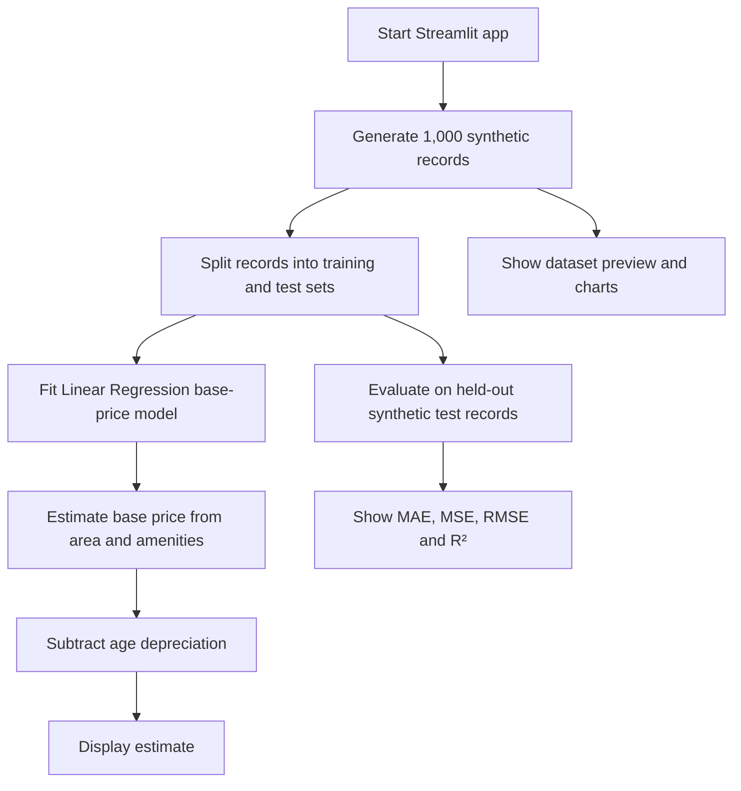

<a id="top"></a>

<div align="center">

# 🏠 House Price Prediction Dashboard

### An interactive Streamlit + Machine Learning demonstration

[](https://streamlit.io/)
[](https://www.python.org/)
[](https://scikit-learn.org/)
[](https://numpy.org/)
[](https://pandas.pydata.org/)
[](https://github.com/abhinavsai830-lang/MachineLearning-Model-Deployment-streamlit)

**Explore house features, estimate a demonstration price, and inspect regression evaluation metrics and visualizations.**

</div>

> [!IMPORTANT]
> **This project uses synthetic data, not real house-sale records.** The app generates 1,000 artificial examples from a predefined illustrative pricing formula. Its evaluation scores show how the model fits that formula; they do **not** establish accuracy for real-world property valuations.

---

## 📚 Table of contents

- [✨ Features](#features)
- [🖥️ Dashboard sections](#dashboard-sections)
- [🧭 How it works](#how-it-works)
- [🧮 Synthetic data and pricing logic](#synthetic-data-and-pricing-logic)
- [📊 Evaluation metrics](#evaluation-metrics)
- [🛠️ Tech stack](#tech-stack)
- [🚀 Run locally](#run-locally)
- [📁 Project structure](#project-structure)
- [🔧 Configuration](#configuration)
- [⚠️ Limitations](#limitations)
- [🗺️ Possible improvements](#possible-improvements)

---

<a id="features"></a>
## ✨ Features

- **Interactive inputs:** set area, bedrooms, bathrooms, house age, and parking in the sidebar.
- **Synthetic dataset:** generate 1,000 reproducible records in code—no external dataset download required.
- **House-price estimate:** calculate an illustrative base price and apply an explicit age depreciation adjustment.
- **Model evaluation:** report MAE, MSE, RMSE, and R² on a held-out test split.
- **Visual exploration:** view Area vs Price, Actual vs Predicted, and Base-Price Model Coefficients.
- **Readable ML explanation:** show the prediction equation and expandable metric explanations.
- **Streamlit dashboard styling:** custom colors, sidebar styling, metric cards, and a prediction card.

<a id="dashboard-sections"></a>
## 🖥️ Dashboard sections

<details>
<summary><strong>🎯 House Price Prediction</strong></summary>

Enter the property details in the sidebar. The result is displayed in Indian rupees, in lakhs. The app keeps the other inputs fixed while the age adjustment is applied.

</details>

<details>
<summary><strong>📊 Model Performance</strong></summary>

The dashboard displays:

- **MAE:** mean absolute error, in lakhs.
- **MSE:** mean squared error.
- **RMSE:** root mean squared error, in lakhs.
- **R²:** proportion of target variation explained on the test set.

</details>

<details>
<summary><strong>🧾 Synthetic Dataset Preview</strong></summary>

Inspect the generated feature and target columns: `Area_sqft`, `Bedrooms`, `Bathrooms`, `Age_years`, `Parking`, and `Price_lakhs`.

</details>

<details>
<summary><strong>📈 Visualizations</strong></summary>

The dashboard contains three tabs:

1. **Area vs Price** — scatter plot of generated records and an area-only trend line.
2. **Actual vs Predicted** — compares true synthetic test targets with predictions.
3. **Feature Coefficients** — displays coefficients for the fitted base-price model. House age is applied separately as a depreciation rule, so it is not a coefficient in this chart.

</details>

<a id="how-it-works"></a>
## 🧭 How it works



### Prediction flow

The base-price model uses area, bedrooms, bathrooms, and parking. House age is applied separately in the demonstration pricing rule:

\[
\text{Predicted Price} = \max\left(0,\ \text{Base Price} - 0.55 \times \text{Age in years}\right)
\]

The age adjustment is **₹0.55 lakhs per year**. It is a configurable illustration for this project, not a rate validated against actual market transactions.

<a id="synthetic-data-and-pricing-logic"></a>
## 🧮 Synthetic data and pricing logic

The dataset is generated inside `app.py` using NumPy's random number generator with a fixed seed. The fixed seed makes the generated records reproducible across runs when the code and library behavior are unchanged.

| Field | Synthetic generation logic |
|---|---|
| `Area_sqft` | Random integer from 500 through 4,000 sq. ft. |
| `Bedrooms` | Area-based estimate plus random variation, clipped to 1–6 |
| `Bathrooms` | Related to bedroom count with variation, clipped to 1–5 |
| `Age_years` | Random integer from 0 through 60 |
| `Parking` | Random integer from 0 through 3 |
| `Price_lakhs` | Base-price formula, minus age depreciation, plus random noise |

The current illustrative base-price formula is:

\[
\text{Base Price} = 12 + 0.028A + 4.2B + 2.3H + 3P
\]

Where `A` is area in square feet, `B` is bedrooms, `H` is bathrooms, and `P` is parking spaces. A random noise value is added while generating the target price. The generated target is clipped at zero so it cannot be negative.

<details>
<summary><strong>Why use synthetic data?</strong></summary>

Synthetic data is helpful for practicing the full machine-learning workflow when an external dataset is not available. The downside is that the model mostly learns the rules used to create the data. A high R² on this dataset should not be interpreted as proof that predictions are accurate for real houses.

</details>

<a id="evaluation-metrics"></a>
## 📊 Evaluation metrics

| Metric | Meaning | Preferred direction |
|---|---|---|
| MAE | Average absolute difference between actual and predicted prices | Lower |
| MSE | Average squared prediction error; larger errors receive more weight | Lower |
| RMSE | Square root of MSE, expressed in price units | Lower |
| R² | Measures how much target variation is explained by the model | Generally closer to 1 is better on comparable test data |

> **Important:** metrics depend on the generated dataset, the random seed, the split, and the chosen synthetic formula. Do not compare these values directly with metrics from real-world housing datasets.

<a id="tech-stack"></a>
## 🛠️ Tech stack

| Tool | Purpose |
|---|---|
| [Python](https://www.python.org/) | Application language |
| [Streamlit](https://streamlit.io/) | Interactive web dashboard |
| [pandas](https://pandas.pydata.org/) | Tabular data preparation and display |
| [NumPy](https://numpy.org/) | Reproducible synthetic data generation and numeric operations |
| [Matplotlib](https://matplotlib.org/) | Charts and visualizations |
| [scikit-learn](https://scikit-learn.org/) | Linear Regression, train/test split, and evaluation metrics |

<a id="run-locally"></a>
## 🚀 Run locally

### 1. Clone the repository

```bash
git clone https://github.com/abhinavsai830-lang/MachineLearning-Model-Deployment-streamlit.git
cd MachineLearning-Model-Deployment-streamlit
```

### 2. Create and activate a virtual environment

**Windows PowerShell**

```powershell
python -m venv .venv
.\.venv\Scripts\Activate.ps1
```

**Windows Command Prompt**

```bat
python -m venv .venv
.venv\Scripts\activate.bat
```

**macOS / Linux**

```bash
python3 -m venv .venv
source .venv/bin/activate
```

### 3. Install dependencies

```bash
python -m pip install --upgrade pip
pip install -r requirements.txt
```

### 4. Start Streamlit

```bash
streamlit run app.py
```

Streamlit normally prints a local URL in the terminal (often `http://localhost:8501`). Open the URL shown by your terminal in a browser.

<a id="project-structure"></a>
## 📁 Project structure

```text
MachineLearning-Model-Deployment-streamlit/
├── app.py             # Streamlit UI, synthetic data, model, metrics, charts
├── requirements.txt   # Python package dependencies
└── README.md          # Project documentation
```

<a id="configuration"></a>
## 🔧 Configuration

The current application defines these constants near the beginning of the synthetic-data section in `app.py`:

```python
RANDOM_SEED = 42
N_RECORDS = 1000
AGE_DEPRECIATION_LAKHS_PER_YEAR = 0.55
```

- Change `N_RECORDS` to generate more or fewer records.
- Keep `RANDOM_SEED` fixed for repeatable sample generation, or change it to explore a different generated sample.
- Change `AGE_DEPRECIATION_LAKHS_PER_YEAR` to experiment with the age adjustment. This is an assumption chosen for demonstration, not a fact about housing markets.

<a id="limitations"></a>
## ⚠️ Limitations

- All records are generated from an illustrative formula; they are not actual housing transactions.
- Location, neighbourhood, property condition, land value, construction quality, market trends, and many other real pricing factors are not represented.
- A high evaluation score on the generated data does not indicate real-world model performance.
- The depreciation rate is manually specified, not estimated from actual property-sale histories.
- Prices are displayed in **₹ lakhs** and are demonstration estimates only.

<a id="possible-improvements"></a>
## 🗺️ Possible improvements

- Add unit tests for synthetic-data generation and the age-depreciation rule.
- Add cross-validation to evaluate how metrics vary across different splits.
- Compare Linear Regression with Ridge and other regression models while keeping the evaluation procedure consistent.
- Add user-controlled synthetic-data size and random seed.
- If real-world predictions become the goal, replace the illustrative generator with licensed, representative, location-aware transaction data and evaluate on an appropriate holdout set.

---

<div align="center">

**Built as a machine-learning learning and deployment project.**

[⬆ Back to top](#top) · [View source code](https://github.com/abhinavsai830-lang/MachineLearning-Model-Deployment-streamlit)

</div>
